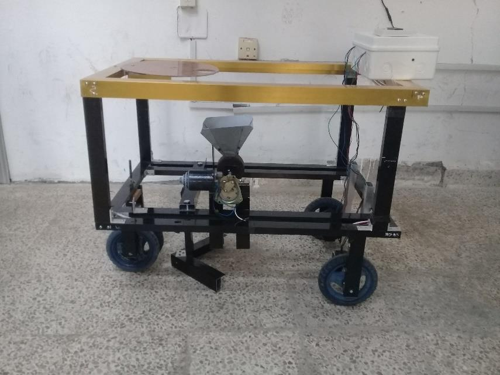
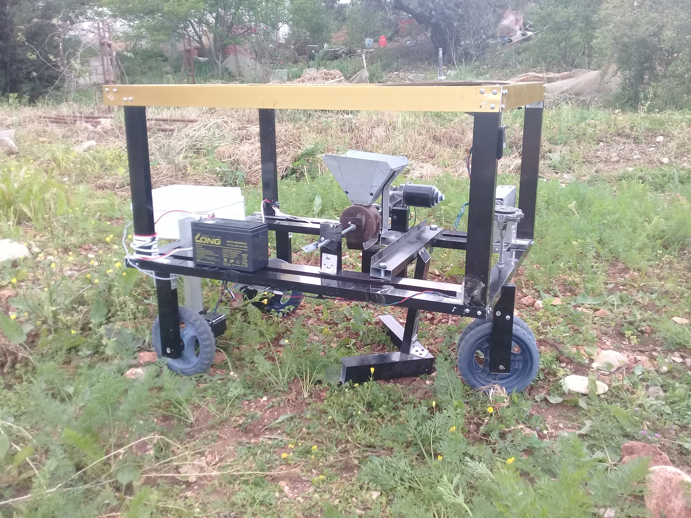
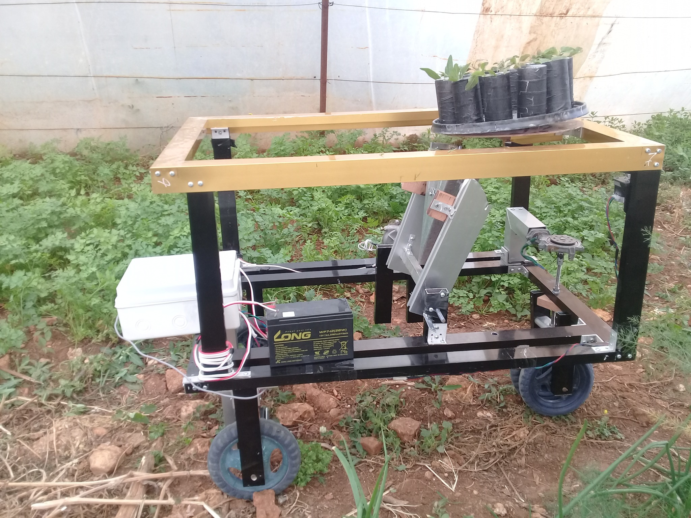
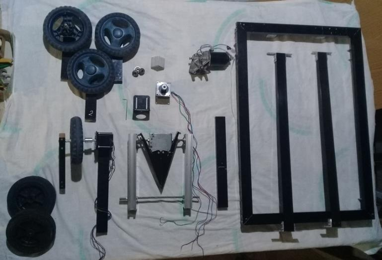
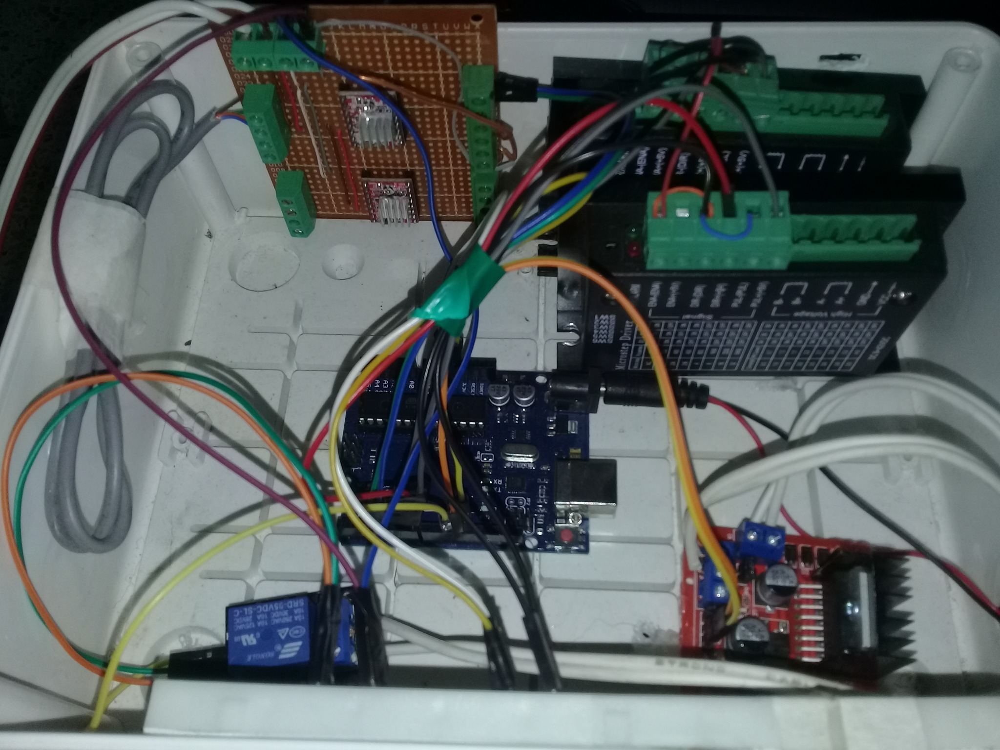

# Agricultural Seeding Robot

A mobile agricultural robot prototype developed for seed sowing and seedling planting in open fields and greenhouses. The design combines a four-wheel platform, planting mechanisms, motor drives, and Arduino-based control.

## My contribution

I designed and built the prototype, including its mechanical structure and planting mechanisms, electrical and electronic systems, motor-control circuits, and Arduino firmware.

## System overview

- **Controller:** Arduino Uno.
- **Operator input:** rotary encoder for entering field dimensions, with an I2C LCD for prompts and values.
- **Motion:** stepper motors controlled through pulse/direction signals and TB6600 drivers.
- **Drive and planting actuators:** DC motors; an L298N driver is used for reversible motor control, while a relay circuit switches the seed-wheel motor.
- **Power:** 12 V battery supply, with a regulated supply for the Arduino.

The firmware reads the configured field dimensions and sequences the robot's movement and planting actuators.

## Firmware

- `firmware/agricalture_robot.ino` — the Arduino sketch used for the prototype.
- Required Arduino libraries: `Wire` and `LiquidCrystal_I2C`.

## Project media

- `images/` — robot overview, components, motor-drive hardware, electronics, and field-test photographs.
- `videos/` — project demonstrations.

## Photo gallery

